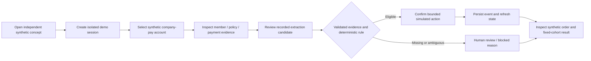

# B4B activation proof — product requirements

**Ayo Ahmed — Independent concept**

> Unofficial concept. All accounts/events are synthetic. No live CRM, outreach, payments or rides.

I propose a small, inspectable company-pay activation workbench. I want a reviewer to follow a synthetic account from setup evidence through a bounded next action to a completed synthetic order, then inspect the event trail and experiment denominator. I am demonstrating a product and engineering approach; I am not presenting prior employment, leadership experience, production results, or an official Bolt product.

## Business context and opportunity

The [public Lead GTM Engineer, B4B role](https://bolt.eu/en/careers/positions/871aaddd-4293-46a0-8f22-bd2d476659ab/) describes B4B across 25+ markets, uneven automation, manual rep time, and a full-funnel mandate. It asks for a 12–18 month roadmap tied to pipeline per rep, cost per SQL, time-to-first-order, activation, and retention; production LLM systems; rigorous evaluation; market adoption; and honest holdouts. I use that mandate to choose a tractable demonstration, not to diagnose an unseen internal system.

The [business portal and support sources](source-context.md) establish employee groups, policies, member invitations, company payment methods, and orders as relevant concepts. I choose company-pay employee work rides because readiness has a clear scope: onboarding can move an employee directly to Active, without requiring a personal payment card. I exclude Ride Booker because group policies do not apply to its trips. I do not assume all services or all languages are supported in every market.

My hypothesis is that making readiness evidence, next-action routing, and outcome measurement visible in one place could help an operator prioritise activation work. I have no evidence that Bolt currently lacks these capabilities or that this concept improves conversion.

## User and job

I design for a hypothetical B4B activation operator who needs to understand what a company-pay account can do next and why. A market lead needs to inspect the same evidence without mistaking a polished demo for a measured business outcome. The full [discovery note](story-and-discovery.md) describes my JTBD and assumptions.

## In scope

- I seed synthetic accounts across three hypothetical operating profiles: UK/en self-service, Lithuania/lt guided, and Kenya/en assisted. These demonstrate process and language variation; they are not regulatory classifications or verified local product availability.
- I expose readiness evidence, deterministic routing, explicit blockers and review paths, a recorded synthetic extraction candidate, operator confirmation, and a synthetic event timeline.
- I simulate bounded activation actions and a synthetic order outcome. I require replay-safe state changes and an auditable reason for each routing decision.
- I retain a fixed experiment cohort through retries, treatment delivery failure, contamination, and incomplete observation. I surface denominators and limitations alongside results.
- I provide an executable evaluation harness, a deliberately failing regression case, and a runbook that distinguishes local verification from public deployment.

## Non-goals

I do not connect Salesforce, enrichment providers, sales-engagement tools, Looker, Databricks, payment systems, or Bolt services. I do not accept real uploads, contact employees or prospects, send invitations, charge cards, book rides, or ingest personal data. I do not implement a production LLM or claim causal lift, revenue, rep savings, or compliant market coverage. I do not model employee-pay, Ride Booker, food availability, enterprise contracting, outbound qualification, or retention interventions in this slice.

## Acceptance criteria

| Requirement | Evidence I require |
| --- | --- |
| Scope is clear before interaction | Independent identity and synthetic/no-live disclaimer visible on desktop and mobile |
| Readiness follows company-pay semantics | An Active member does not require a personal payment card; Invited, Invite expired and Active remain distinguishable |
| A recommendation is inspectable | The UI shows evidence provenance, source/fixture identifiers, blocker/review reason, and the action permitted |
| Extraction cannot silently become an action | Recorded candidate, validation, review decision, and deterministic routing are separate |
| Mutations survive refresh and retry | Same-session persisted state; duplicate operation does not count twice; another session cannot mutate it |
| Metrics preserve the cohort | ITT numerator and denominator, observation window, exposure and contamination are visible |
| Regression is observable | Normal evaluation passes; injected broken rule produces a failing report |
| External effects are absent | Routes and bindings have no CRM, enrichment, outbound, payments, or ride integration |

I record the commands and observed results in [the runbook](runbook.md). Acceptance criteria above are requirements, not a substitute for those results.

## Journey

I keep member status distinct from account activation. A member can be Active while the account has never completed an order. For this concept I define account activation as its first completed synthetic company-pay work-ride order. That definition is an analytical choice, not an official Bolt status or billing event.

## Success and decision rule

For the proof itself, I prioritise correct state changes, transparent uncertainty, reproducible evaluation, accessible interaction, session isolation, and honest measurement. For a future authorised pilot, I would measure time-to-first-order and activation on a prespecified cohort, with retention and operator burden as follow-up outcomes. I would stop expansion if readiness accuracy, safety, adoption, or denominator integrity fails, even if a headline synthetic comparison looks favourable.

The Bolt name and logo are trademarks of Bolt Technology OÜ or its affiliates. All rights reserved.
