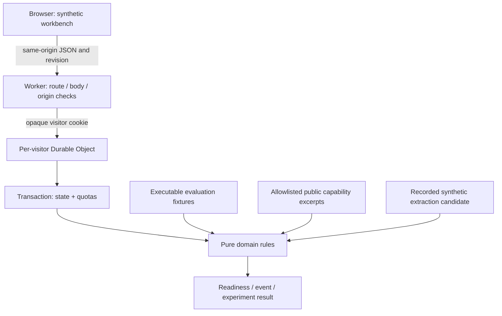

# My architecture, API and safety decisions

**Ayo Ahmed — Independent concept**

> Unofficial concept. All accounts/events are synthetic. No live CRM, outreach, payments or rides.

I implement a frontend with a same-origin Cloudflare Worker API, a pure domain state machine, and a SQLite-backed Durable Object per visitor capability. The domain rules and evaluation harness share the same functions. I keep the backend small so a reviewer can trace a recommendation to its evidence, mutation and metric.

There is no live model, outbound provider, CRM, enrichment, warehouse, payment or ride connection in this graph. The source catalog records public capability statements; synthetic fixture facts supply the pretend account context.

## API contract

| Route | Method | Contract |
| --- | --- | --- |
| `/api/state` | GET | Creates an isolated session when no valid capability cookie is supplied; returns its persisted state |
| `/api/command` | POST | Requires existing visitor cookie, `application/json`, bounded body and integer `expectedRevision`; applies one domain command |
| `/api/evaluations` | GET | Runs the current evaluation cases; `?broken=1` deliberately substitutes a broken extraction validator |

The API uses a cryptographically generated 256-bit opaque `b4b_session` cookie as a visitor capability, with HttpOnly, SameSite=Strict, Path=/ and 24-hour Max-Age; HTTPS adds Secure. This is demo session isolation, not employee authentication or a production tenant permission system. A different visitor capability addresses a different Durable Object. State is persisted across reloads and local Worker restarts when the local persistence directory is retained. Static assets also run through the Worker, which applies the same security headers.

I reject an explicit cross-origin Origin, unknown API routes, wrong methods, malformed UTF-8/JSON and oversized bodies. A mutation without a loaded session returns `SESSION_REQUIRED`; one without a revision returns `REVISION_REQUIRED`. Domain validation failures normally return 400; revision, idempotency-payload and stale-import conflicts return 409; capacity limits return 429. Session expiry returns 410 and clears the cookie. JSON responses are no-store.

### Commands

Every POST command has `type` and `expectedRevision`. Account commands also specify `accountId`. Unknown command fields are rejected. I use `eventId` for order and message operations so retries return the stored result without creating a second effect; reusing a key for a different payload is a conflict.

| Type | Additional fields | Behaviour |
| --- | --- | --- |
| `select_market` | `marketId` | Select one hypothetical profile; does not alter the frozen experiment cohort |
| `resolve_prerequisite` | `accountId`, `prerequisite` | Resolve billing, member, group or service in synthetic state; renewal is valid only for an expired invitation and moves it to Invited, then requires separate member onboarding to Active; repeated resolution preserves the prior first-ready timestamp |
| `record_extraction` | `payload` | Validate the recorded synthetic candidate; accept evidence or record rejection reasons. Rejection preserves the last accepted account evidence; first acceptance records the evidence gate timestamp |
| `simulate_order` | `accountId`, `eventId`, optional canonical `occurredAt` | Accept only ready, in-window, nonfuture synthetic events; track earliest accepted first order |
| `queue_message` | `accountId`, `eventId`, `channel` (`email` or `sms`) | Create a synthetic outbox preview or suppression reason; never send externally |
| `change_preferences` | `accountId`, `optedOut` | Change synthetic messaging preference |
| `record_exposure` | `accountId` | Record manual synthetic exposure, including visible holdout contamination |
| `preview_import` | `rows` | Validate 1–20 synthetic rows and retain one preview with its base revision |
| `commit_import` | `previewId` | Commit a valid, current preview atomically; imported accounts stay outside the fixed cohort |
| `advance_clock` | `hours` | Advance the explicit simulation by more than zero and at most 192 hours per command |
| `demo_reset` | — | Re-seed only this visitor's fixtures, increment generation/revision and clear synthetic receipts; request quotas remain |

My successful synthetic import is not a real upload or an enrichment path. Imported accounts have no trusted fixture evidence, remain blocked for qualification, and cannot expand the allowlisted extraction fixtures or experiment denominator. `cohortExcluded` marks that account boundary; outbox `excluded`/`exclusionReason` describe experiment exclusion separately from a messaging suppression reason.

## State and extraction schema

| Record | Key fields and invariants |
| --- | --- |
| Session state | `revision`, `generation`, explicit `now`, selected profile, accounts, audit, outbox, receipts, preview, extraction records and experiment |
| Account | Synthetic ID/name/profile, company-pay ride scope, billing/member/group/service gates, invitation status, preferences, evidence, gate timestamps, first order and exposures |
| Derived qualification | `qualified`, `abstain` (unknown), or `escalate` (invalid/stale/future evidence), with owner and reason |
| Derived readiness | Ordered missing prerequisites, boolean ready, owner and next action; qualification is required |
| First order | Event ID and canonical UTC timestamp; at most one first-order outcome per account |
| Receipt | Event ID, canonical payload fingerprint, stored result and simulation time; detects replay and payload conflict |
| Audit | Synthetic timestamp, action type, account ID and result; bounded diagnostic trace, not a permanent compliance ledger |
| Experiment | Frozen seeded IDs, start/end, stable assignment specification; summary derives from stored outcomes and exposures |

The extraction candidate requires `schemaVersion: 1`, `synthetic: true`, `fixtureId`, `accountId`, `service: "ride"`, `paymentMode: "company_pay"`, boolean `businessUse`/`consentToSetup`, matching fixture language, numeric confidence in [0,1], canonical `observedAt`, and 1–3 evidence references. Unknown fields are rejected. A reference must contain only source ID, claim and exact excerpt matching the catalog. Unknown fixture pairs, fact mismatch, employee-pay/Ride Booker and instruction-like content are rejected. Evidence older than seven simulated days or future-dated escalates. Confidence does not override provenance or readiness.

```mermaid
stateDiagram-v2
  [*] --> UnknownEvidence
  UnknownEvidence --> Qualified: valid recorded synthetic extraction
  UnknownEvidence --> UnknownEvidence: rejected candidate logged for review
  Qualified --> Qualified: rejected candidate; accepted evidence retained
  Qualified --> Review: evidence stale or future dated
  Qualified --> SetupBlocked: prerequisite missing
  SetupBlocked --> Ready: required synthetic gates resolved
  Ready --> Activated: accepted first synthetic completed order
  Ready --> Ready: duplicate same event and payload
  Review --> Qualified: valid refreshed fixture evidence
```

This diagram describes analytical readiness and activation. It does not rename official member statuses: in company-pay, completed onboarding can make a member Active; account activation here still requires the first completed synthetic order.

## Architecture decisions

I choose deterministic routing so eligibility and reasons are reproducible. I demonstrate the contract a future extraction component would have to satisfy without making a model's plausible text an instruction. I choose transactionally persisted per-visitor state to make reload, concurrency and retry behaviour inspectable. I require optimistic revision checks so a stale page refreshes before changing state. I freeze cohort membership to prevent imports or exposure failures from flattering a result.

I choose a bounded simulated outbox rather than real outreach. It suppresses opted-out, holdout, already-activated, unqualified, invitation-expired and out-of-window accounts; within a day it deduplicates the same channel and caps queued contact at one. These are demonstration controls, not a complete outbound consent or communications-policy implementation. A suppressed event is retained so a reviewer can see what did not happen. Audit import entries summarise row count and the first twenty error row/field/code records rather than repeat bulk raw rows; extraction audit entries summarise acceptance and error codes. The current import preview still retains full inspectable synthetic rows.

For a production LLM integration I would retain the validator/rule boundary and add approved data contracts, provenance, versioned evaluation, permissions, timeouts, fallback, monitoring and operator ownership. I describe that proposal in [the evaluation plan](experiment-plan.md); it is not deployed functionality.

The role explicitly includes GDPR for outbound/enrichment and EU AI Act readiness. This synthetic proof does not establish legal compliance. Before live data or a live model, I would map purposes, data flows and market-specific obligations with privacy/legal owners; establish the applicable lawful basis, minimisation, retention, access/deletion and transfer/vendor controls; and determine whether the proposed AI use falls within relevant obligations. A demo opt-out flag or a country/language profile is not a lawful-basis determination, a regulatory classification or permission to contact anyone.

## Threat and abuse limits

| Failure or threat | Implemented control | Residual limit |
| --- | --- | --- |
| Hostile or hallucinated extraction | Strict schema, exact source/fixture allowlist, instruction-pattern rejection, deterministic rules | Pattern matching is not a universal prompt-injection defence; no live untrusted documents or model are accepted |
| Cross-visitor writes | Unguessable capability cookie maps to isolated Durable Object | A stolen cookie grants access to that demo session; no named-user identity or production tenant authorisation |
| Stale page/concurrent mutation | Required revision plus storage transaction | A client must refresh and review after conflict |
| Duplicate event / changed replay | Stored payload fingerprint and result | Reset creates a new synthetic receipt namespace; this is not durable payment idempotency |
| Large body / growing state | Streaming 24 KiB body bound, bounded arrays and accounts | Limits reduce per-session cost; they do not cap global new-session creation |
| Cross-origin browser mutation | SameSite cookie, explicit Origin rejection, same-origin CSP | Requests without Origin are allowed; capability possession remains the authority |
| Script injection / embedding | Same-origin scripts/fonts/connect, frame denial, nosniff, no-referrer | CSP allows inline styles; controls need independent review before live data use |
| Misleading outreach or impact | Synthetic previews, suppression reasons, fixed denominators and prominent scope | A reviewer still needs to read interpretation and incomplete-window caveats |

Per session I bound accounts to 48, import rows to 20, event receipts to 150, audit entries to the latest 200 (with a trimmed counter), outbox items to 50, and accepted/rejected extraction histories to 30 each. I also cap final serialised state at **110 KiB (112,640 bytes)**: whichever bound is reached first blocks further growth. The pure domain rules reject an oversized mutation while preserving original state, and the Worker repeats the check before storage.

I bound requests reaching the Durable Object to 30 per minute and 240 over a 24-hour session. Reset does not reset these request quotas. Malformed JSON, content-type, body-size and Origin rejections occur earlier at the Worker edge and do not consume the Durable Object quota; invalid public traffic is not globally capped. An expiry alarm deletes stored session data; an expired capability cannot silently re-create its old state.

**New-session abuse remains open:** an unauthenticated visitor can clear or omit the cookie and create another session. There is no global/IP issuance cap, bot challenge, account-wide spend cap or authenticated admission control. Per-session limits therefore do not establish safe public operating cost. Before public deployment I would verify the approved account and free-plan eligibility, configure issuance/traffic controls and spend alerts, and review platform limits. I would not describe this proof as production-ready.

## Deployment boundary

The current Cloudflare credential check returned **HTTP 400, code 1001, “Missing Authorization header”**. No scoped Cloudflare authentication, approved destination/account or free-plan verification is available, so public deployment is blocked. I do not treat a local URL or successful local test as a public demo URL. No live-service or outbound credentials are configured. The [runbook](runbook.md) records local commands and observed verification.

The Bolt name and logo are trademarks of Bolt Technology OÜ or its affiliates. All rights reserved.
